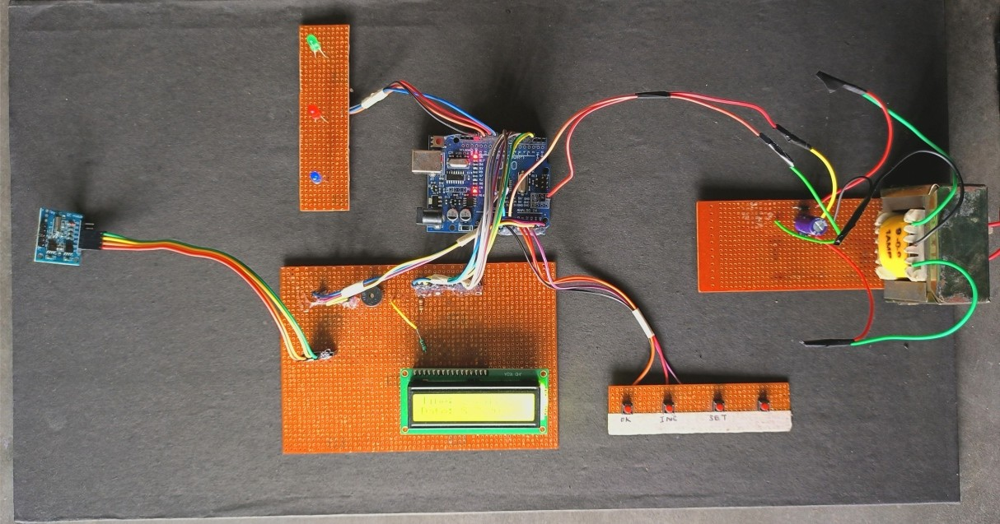
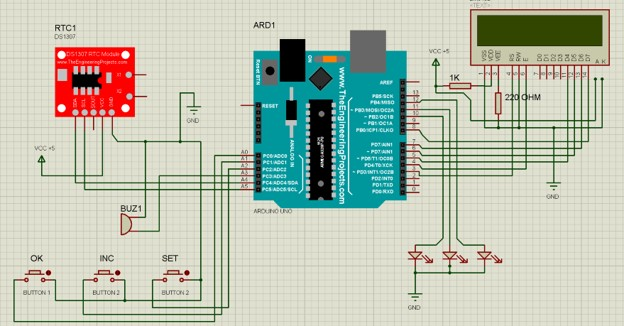

# Smart Medicine Reminder System

## Project Overview

The **Smart Medicine Reminder System** is an Arduino-based embedded
system designed to assist users in maintaining their medication
schedules. The system uses a real-time clock module to track time and an
LCD display to provide medication-related information and reminders.

The primary objective is to simplify medication management through an
automated reminder mechanism and help users avoid missing their
scheduled medication timings.

## Objectives

1.  Develop an automated medicine reminder system using Arduino.
2.  Implement real-time clock functionality for accurate time tracking.
3.  Display time and medication-related information through an LCD
    module.
4.  Provide timely reminders based on predefined medication schedules.
5.  Demonstrate the practical application of embedded systems in
    healthcare.

## Hardware Components

  -----------------------------------------------------------------------
  Component                           Description
  ----------------------------------- -----------------------------------
  Arduino UNO                         Main microcontroller for system
                                      operation and control

  20×4 LCD Display (HD44780)          Displays medication schedules, time
                                      and system information

  DS3231 RTC Module                   Maintains accurate real-time clock
                                      and date information
  -----------------------------------------------------------------------

## Software Requirements

1.  Arduino IDE
2.  Arduino Programming Language (C/C++)

## Working Principle

The system uses an Arduino microcontroller as its central processing
unit. The DS3231 Real-Time Clock (RTC) module maintains accurate time
and date information and communicates with the Arduino through the I2C
interface.

The 20×4 LCD display, based on the HD44780 controller, provides a visual
interface for displaying relevant information to the user.

The Arduino processes the time information received from the RTC module
and manages the reminder mechanism according to the programmed
medication schedule. When a scheduled medication time is reached, the
system activates the corresponding reminder mechanism.

## Project Images

### Hardware Implementation

The following image shows the hardware implementation of the Smart Medicine Reminder System.



### Circuit Diagram

The circuit diagram illustrates the hardware connections and interfacing between the Arduino UNO, 20×4 LCD display, and DS3231 RTC module.



## Applications

1.  Medication schedule management.
2.  Assistance for elderly individuals.
3.  Home healthcare applications.
4.  Automated healthcare reminder systems.

## Learning Outcomes

1.  Practical experience in Arduino programming and microcontroller
    interfacing.
2.  Understanding of Real-Time Clock (RTC) modules and time-based
    applications.
3.  Interfacing LCD displays with microcontrollers.
4.  Understanding of I2C communication.
5.  Integration of hardware and software in embedded system development.

## Repository Structure

``` text
Smart-Medicine-Reminder-System/
│
├── Images/
│   ├── circuit_diagram.jpg
│   ├── project_setup.jpg
│   └── .gitkeep
│
├── README.md
├── medicine_reminder.ino
└── medicine_reminder_ppt.pptx

## Project Information

**Project Name:** Smart Medicine Reminder System

**Domain:** Embedded Systems

**Microcontroller:** Arduino UNO

**RTC Module:** DS3231

**Display:** 20×4 LCD (HD44780 Controller)

**Programming Language:** C/C++

**Development Environment:** Arduino IDE

## Project Documentation

The project presentation and supporting documentation are available in
the `Presentation` directory of this repository.

------------------------------------------------------------------------

*This project was developed as an academic implementation of
microcontroller-based automation for healthcare applications.*
